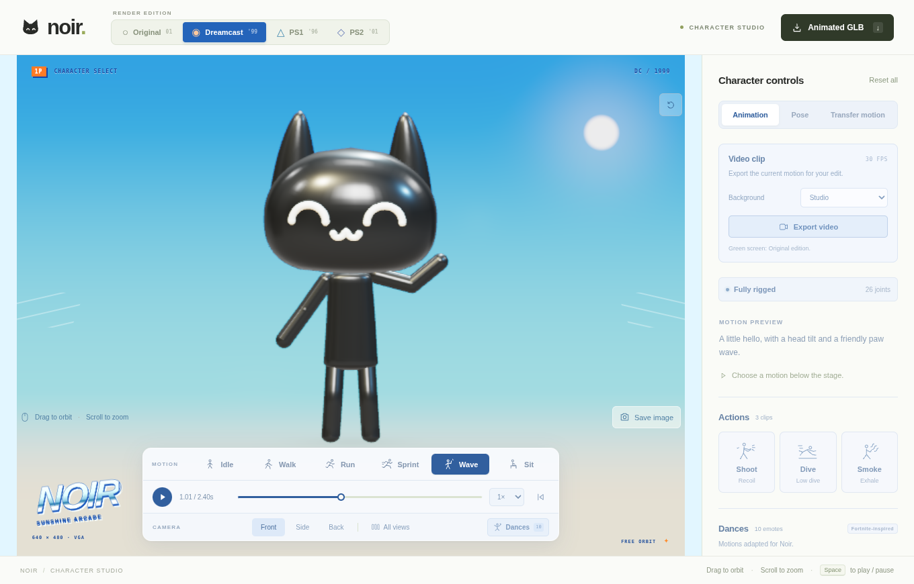
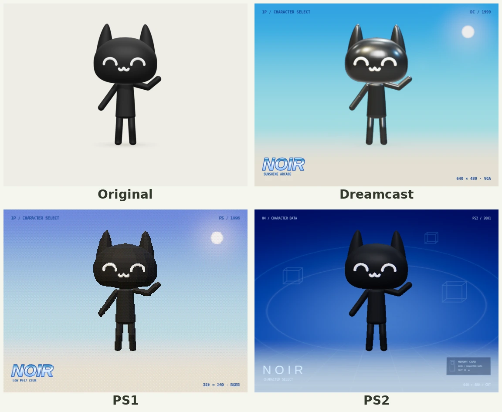

# Noir — Character Studio

[Open the studio](https://new1direction.github.io/noir-cat-studio/) · [Download the models](https://github.com/New1Direction/noir-cat-studio/releases/latest) · [View the source](https://github.com/New1Direction/noir-cat-studio) · [Report an issue](https://github.com/New1Direction/noir-cat-studio/issues)

A procedural Three.js character studio built from the supplied black-cat reference. Noir has a real 26-joint skeleton, skinned geometry, nineteen portable animations, facial controls, and hand/foot IK. All geometry, skin weights, props, and animation are authored in JavaScript; Blender and imported character models are not required.



## Start in your browser

Open the [live studio](https://new1direction.github.io/noir-cat-studio/). No installation, account, or wallet is required.

1. Choose a motion in **Animation**, **Actions**, or **Dances**. Play, pause, or scrub to a frame.
2. Choose **Original**, **Dreamcast**, **PS1**, or **PS2**, then adjust the color, camera, and pose.
3. Export a **Video clip** for reuse in a video editor, an **Animated GLB** for a 3D app, or a still with **Save image**.

For your own moves, open **Transfer motion** and choose a local, full-body video. Select a 0.2–20 second segment and click **Copy my moves**. Your selected video, audio, and captured poses are processed on your device and are not uploaded. Captured motion lives in the current tab: **export it before closing or refreshing the tab**.

This public source snapshot is version **1.0.0**, with **19 built-in rigged motions** and **147 automated regression tests**. The controls, export formats, rig, and console-inspired editions are documented below.

## Run locally

Requires Node.js 20.19+ or 22.12+.

```sh
git clone https://github.com/New1Direction/noir-cat-studio.git
cd noir-cat-studio
npm ci
npm run dev
```

Open the local URL printed by Vite. The development server reloads when you edit the source.

## Test, build, and export models

```sh
npm test
npm run build
npm run preview
```

`npm test` runs the rig, animation, motion-transfer, and GLB regressions. Video export is checked separately in browser QA. `npm run build` creates the production site in `dist`; `npm run preview` serves that build locally.

Prebuilt GLBs for all four editions are also available in the [latest release](https://github.com/New1Direction/noir-cat-studio/releases/latest), with the MIT license, usage instructions, model manifest, and checksums.

To generate all four animated models without opening the studio:

```sh
npm run export:models -- ./exports
```

The export command writes `noir-original-rigged.glb`, `noir-dreamcast-rigged.glb`, `noir-ps1-rigged.glb`, and `noir-ps2-rigged.glb`, plus `noir-model-manifest.json` with triangle counts, clip names, file sizes, and validator results. Each model includes the 26-joint rig and all nineteen built-in motions. See the [elbow audit](ELBOW_AUDIT.md), [knee audit](KNEE_AUDIT.md), and [tests](tests/) for the validation coverage.

## GitHub Pages deployment

The [live studio](https://new1direction.github.io/noir-cat-studio/) is hosted by GitHub Pages. The [Check and deploy studio](.github/workflows/deploy.yml) workflow installs the locked dependencies, runs all 147 tests, builds the site, and publishes `dist` when changes are pushed to `main`. Pull requests run checks without deploying. You can also start the workflow manually from GitHub Actions.

In the repository's **Settings → Pages**, choose **GitHub Actions** as the source. Vite uses the relative base path `./`, so forks and renamed repositories can deploy without changing asset paths.

## Studio controls

- **Motion:** Idle, Walk, Run, Sprint, Wave, and Sit. Walk has heel-to-toe contact and close arm swings. Run has relaxed, bent elbows with room beside the torso; Sprint adds a longer stride, deeper forward drive, and more flight time. The three gaits play in place. Sit lowers into a held pose with relaxed upper arms and paws resting by the knees.
- **Actions:** Shoot uses a stylized blaster, anticipation and recoil; Dive compresses, launches sideways, and lands low; Smoke brings a small smoking prop toward the mouth and lowers it after the draw. Shoot and Dive play once and hold. Click their tile to replay. Smoke loops. Prop visibility and orientation are baked into every clip so switching actions and exporting GLBs stays consistent.
- **Dances:** ten Fortnite-inspired emotes adapted to Noir's proportions: Floss, Orange Justice, Best Mates, Take the L, Electro Shuffle, Fresh, Dance Moves, Dab, Hype, and Groove Jam. Open the dance library from the stage or choose a tile in Animation. Each dance loops and supports scrubbing, playback speed, posing, and all four editions. These are original procedural adaptations; no game animation files or music are bundled.
- **Playback:** play/pause, timeline scrubbing, speed, and rewind. Space toggles playback when a form control is not focused.
- **Pose:** freeze the current frame, adjust head turn/tilt, arm raise, tail sway, blink, and smile. Reset Pose returns to the neutral idle frame.
- **IK:** select a hand or foot, then drag the translation handle. Skeleton toggles the joint overlay. The solver limits unreachable targets to the limb's reach.
- **Camera:** drag to orbit, scroll/pinch to zoom; Front, Side, Back, and All views preserve animation. Keys 1–4 work when the viewer is focused.
- **Editions:** switching keeps the clip, animation time, color, pose, and camera. Each edition remembers its material roughness.
- **PS2 moods:** Character Select and Foggy Town. These are artistic console-inspired treatments, rather than hardware emulators.
- **Animated GLB:** exports a real skeleton, normalized skin weights, materials, props, and all nineteen animation clips. Exporting from Pose also includes a baked `Custom Pose` clip with solved IK, facial controls, and current props. Each file is optimized and checked with Khronos glTF Validator before download.
- **Video clip:** records one cycle of the current motion, at the selected playback speed, without the studio interface. Studio backgrounds work in all editions; Original also offers a green screen for compositing in a video editor. The browser saves WebM (or MP4 when supported). Cancel stops the recording, and the prior playback frame and controls are restored afterward.
- **Transfer motion:** choose a local video of one person, trim a 0.2–20 second segment, and click **Copy my moves**. MediaPipe Pose Landmarker runs in a worker on this device using the runtime and model bundled with the app. The selected video, audio, and pose data are not uploaded. Use a fixed camera, good light, and a full-body view with both feet visible. Browser codec support applies; MP4/H.264 and WebM are good choices. Source files may be up to 250 MB and longer than the selected segment.
- **Captured motion:** the resulting **Your motion** clip supports timeline scrubbing, all four styles, pose tools, video export, and animated GLB export alongside the nineteen built-in clips. Mirror, smoothing, foot locking, and optional loop closing can be adjusted without tracking the video again. Capture data lives only in the current tab: export the clip before closing or refreshing. Fast turns, occluded limbs, and ground acrobatics may need a clearer source or cleanup; Noir's short limbs and oversized head require adapted poses.
- **Save image:** captures the current animation frame. Dreamcast and PS2 captures are 640×480; PS1 is 320×240; Original uses native resolution.

Reduced-motion preferences pause initial animation. No account or server-side motion service is needed to use the studio. The last edition and PS2 mood are remembered locally. `?edition=original` (or `dreamcast`, `ps1`, `ps2`) links directly to an edition. Add `&motion=Sprint` or `&motion=Shoot` to start any built-in clip. Existing `&dance=Floss` links continue to work (URL-encode names containing spaces). `&panel=capture` opens Transfer motion.

## Rig and animation

All four meshes share the same 26-joint layout: root, hips, spine, head; two ears; two eyes and mouth; shoulder/elbow/hand chains; hip/knee/foot chains; and a five-joint curled tail. Meshes have no more than four normalized influences per vertex. Each arm combines two rigid shafts and a round elbow surface in one skinned mesh. Deep bends retain their thickness, and wrist rotation moves the hand attachment without crushing the rounded paw cap. The oversized head retains its toy silhouette.

Animations use Three.js clips and quaternion tracks. Gaits are authored with analytic two-bone IK and sampled into ordinary bone animation tracks, so runtime controls are not required to play the exported clips. Built-in motions, manual IK, and transferred video share the same solver. A consistent elbow bend plane prevents unintended forearm twist, and solving in model coordinates keeps poses consistent when the character is placed, rotated, or scaled. Tail follow-through, ear reactions, and blinks are baked into the clips. The live pose tool applies its offsets and IK after the animation mixer without accumulating drift.

All nineteen built-in clips have checks for both elbows, with gesture-specific bend direction, free-arm torso clearance, head clearance, and smooth loop or held-pose behavior across all four editions. Both knees are checked in the character's frame, including crossed dance steps and the sideways dive. GLB roundtrip checks compare both exported arm and leg joint paths with the studio. See the [elbow audit](ELBOW_AUDIT.md) and [knee audit](KNEE_AUDIT.md) for coverage and corrections.

The front faces +Z, the feet rest at y=0, and bind-pose height is approximately 6.08 arbitrary scene units. Scale the whole character to fit a different project.

```js
import { createCat } from './src/cat.js';
import { rigCat } from './src/rig.js';
import { createAnimator } from './src/animation.js';

const cat = rigCat(createCat({ style: 'original', color: '#202021' }));
const animator = createAnimator(cat);
scene.add(cat);
animator.play('Walk');
// In your render loop:
animator.update(deltaSeconds);
```

`cat.userData.rig` provides the skeleton, named bones, bind transforms, meshes, and `resetPose()`. `cat.userData.materials` provides the fur and face materials. `cat.userData.parts` provides named surface references. Use `exportAnimatedGLB()` in `src/export.js` rather than JSON-stringifying runtime `userData`.

## Visual profiles



| Edition | Triangles per rigged cat | Treatment |
| --- | ---: | --- |
| Original |81,712| Smooth matte geometry and native-resolution studio lighting |
| Dreamcast |8,584| Glossy clearcoat, sunny lighting, 640×480, gentle VGA softness |
| PS1 |2,752| Baked flat normals, 320×240, RGB5 dithering and screen-space vertex snapping |
| PS2 |14,280| Smooth normals, satin material, baked vertex colors, 640×480 CRT softness and subtle interlacing |

The GLB contains geometry, skins, materials, PS2 vertex colors, and animation. Backgrounds, scene lights, CRT treatment, fog, dithering, and PS1 vertex snapping remain viewer effects.

## Source map

- `src/cat.js` — procedural surfaces and four geometry profiles.
- `src/rig.js` — shared skeleton, arm topology, skin weights and bind pose.
- `src/animation.js` — sampled clips, playback, facial offsets and IK.
- `src/limb-ik.js` — shared two-bone solving with a consistent elbow bend plane.
- `src/dances.js`, `src/dances-classic.js`, `src/dances-party.js` — dance catalog and procedural choreography.
- `src/actions.js`, `src/action-props.js` — action choreography, props, and portable prop animation.
- `src/video-export.js` — clean browser video capture, cancellation, and media cleanup.
- `src/motion-capture.js`, `src/pose-worker.js` — local video decoding and worker-based pose tracking.
- `src/motion-retarget.js` — pose calibration, confidence filtering, IK, foot locking, head clearance, and portable clip baking.
- `src/capture-controls.js` — source-video lifecycle, trim/settings controls, and captured-motion preview.
- `public/mediapipe/` — pinned MediaPipe runtime/model, license, and asset hashes; loaded when motion capture starts.
- `src/export.js` — skeleton cloning, animation export, optimization and validation.
- `src/retro-renderer.js` — console render targets and image treatments.
- `src/main.js` — studio controls, lighting, cameras and interaction.
- `index.html`, `src/style.css` — responsive studio interface.
- `scripts/export-models.mjs` — reproducible exports of all four rigs, with a validation manifest.
- `tests/rig.test.mjs` — geometry, skinning, animation, contact, IK and export regressions.
- `tests/arm-surface.test.mjs`, `tests/limb-ik.test.mjs` — elbow radius/volume, paw caps, bend-plane stability, placement, and export regressions.
- `tests/dances.test.mjs` — dance identity, loop continuity, and floor-contact regressions.
- `public/reference.png` — supplied reference for comparison only.

See `THIRD_PARTY_NOTICES.md` for dependency licenses. Google Fonts have system fallbacks; model geometry and rendering assets are generated locally.

## License

The original project code, procedural 3D model, and original animations are available under the [MIT License](LICENSE). Anyone can use, modify, and share them, including in their own videos and projects. Preserve the license notice when redistributing the code or model.

Third-party libraries and the MediaPipe tracking model retain their own licenses; see [THIRD_PARTY_NOTICES.md](THIRD_PARTY_NOTICES.md). The supplied 2D reference image is included for comparison and is not covered by the project's MIT grant.

## Community

Use [GitHub Issues](https://github.com/New1Direction/noir-cat-studio/issues) to report bugs or suggest motions and improvements. For a visual bug, include the edition, motion name, playback time, and browser so the pose can be reproduced.
